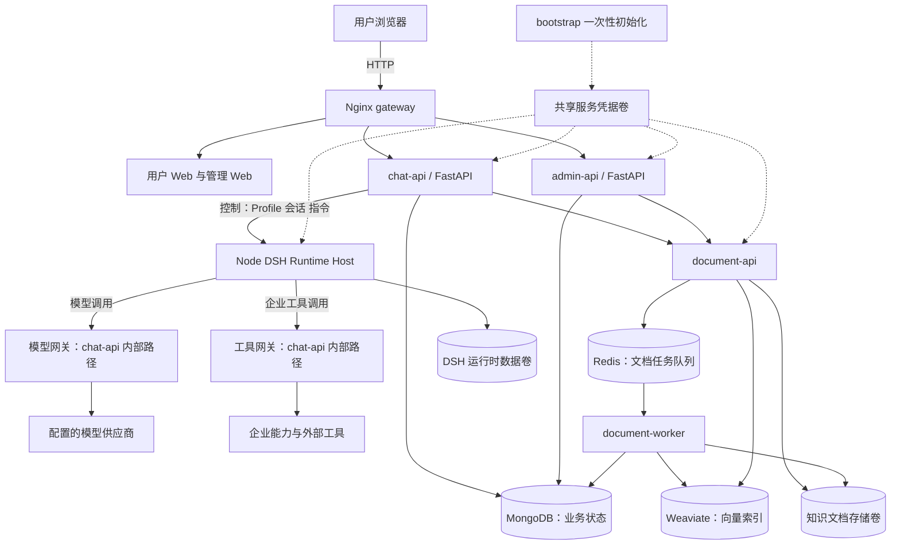
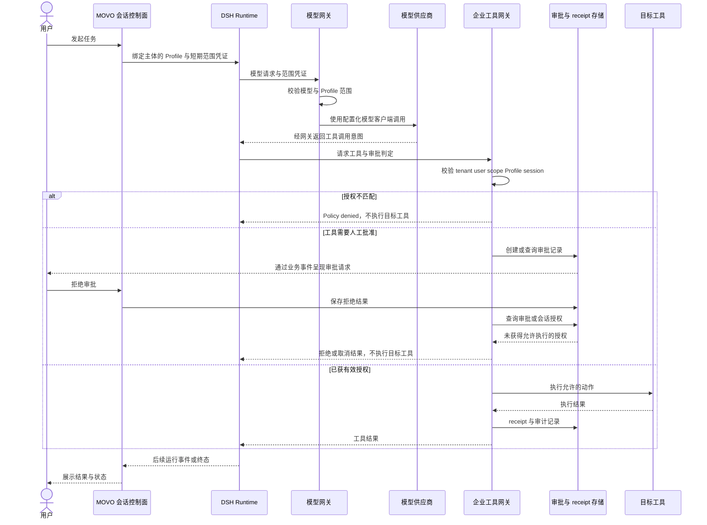
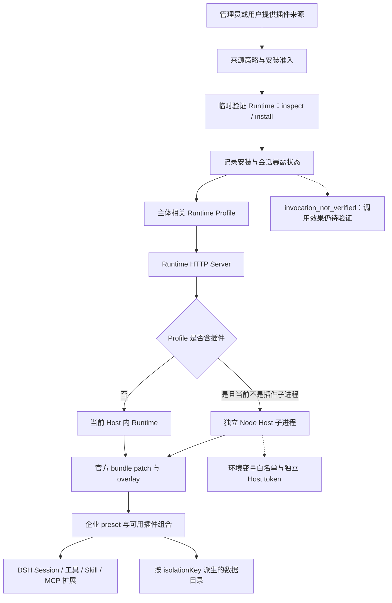
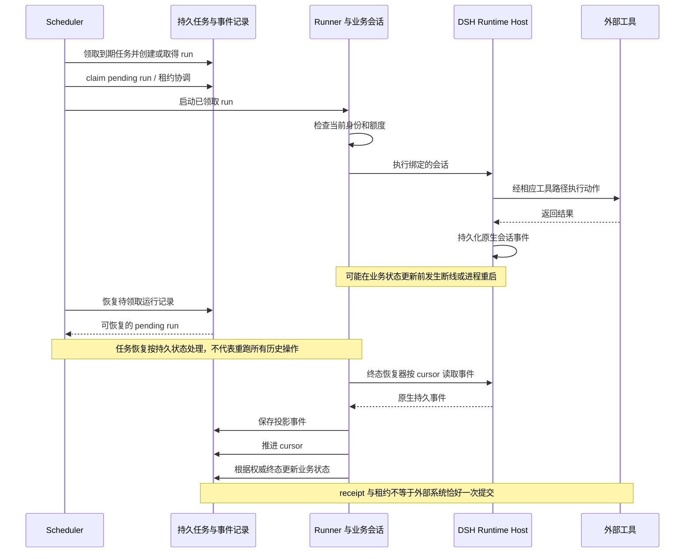

# MOVO 竞品分析：DSH 企业平台封装、治理边界与采用判断

> 评估日期：2026-10-23。评估对象：MOVO Community 公开源码，固定提交 `f53b26be9f45a5cef2d001e8332b915b39056640`。当日 GitHub 最新 Release 为 `v0.2.5`，发布时间为 2026-10-23 10:05:54 UTC。全文为**公开资料与源码静态评估**：没有安装或运行 MOVO，没有运行其测试、调用模型、接入业务系统或进行性能、安全攻击验证。版本号、公开宣传、代码存在、作者测试通过和本次实测是不同证据层级。

## 1. 结论与阅读方式

MOVO 值得作为 DSH 企业平台的重点对标对象，并进入隔离 PoC。它的价值不只是聊天界面，而是把 DSH 原生运行时与身份、模型配置、企业工具、知识文档、任务状态和运营后台连接成产品。公开代码已经包含模型及工具网关、版本化 Runtime Profile、插件装配、任务调度与终态恢复等具体工程实现。[产品说明][readme]、[运行时目录][runtime]

但不宜直接把 Community 当作强隔离、多人员细粒度权限或合规审计的完整安全控制面。社区资源过滤边界明确不提供人员级 Skill／Tool／Plugin ACL；插件子进程与目录隔离不等同于每用户 OS 沙箱；审批绑定、即时撤权、恢复后的外部副作用以及审计持久性仍需专项验收。上述判断不代表“没有鉴权”，也不是已确认漏洞结论。[资源访问策略][acl]、[工具授权][toolservice]、[插件子进程][isolated]

优先借鉴三点：以短期范围凭证连接模型和工具网关；用锁定版本、契约与 overlay 适配 DSH；把会话事件、业务状态和任务恢复拆开治理。若目标是企业平台产品化，应把权限、隔离和可恢复副作用作为独立建设项，而不是从“enterprise-ready”宣传推导已满足。[模型凭证][modeltoken]、[兼容矩阵][matrix]、[终态恢复][recovery]

本文标记含义如下：

| 标记 | 含义 | 不能据此推导 |
| --- | --- | --- |
| 源码事实 | 固定提交中能定位到实现或配置 | 全场景有效、部署安全、无缺陷 |
| 作者证据 | README、官网、矩阵、CI 状态等作者提供的信息 | 本报告已复现或第三方认证 |
| 静态判断 | 根据调用链和实现边界作出的工程分析 | 可利用漏洞、性能或可用性承诺 |
| 待验收 | 采用前需要实验或厂商材料确认 | 目前已支持或目前必定不支持 |

## 2. 产品定位与版本证据

MOVO 将自己定位为 source-available、DSH-native 的企业 Agent 平台。官网把 DSH 视为规划、工具、Skill 与子 Agent 的运行内核，把 MOVO 视为身份、知识、治理、集成及运维控制层。这是产品定位；商业能力覆盖范围仍需以发行物、文档与合同逐项确认。[官网](https://www.himovo.com/en/)

| 对象 | 本次依据 | 评估边界 |
| --- | --- | --- |
| MOVO 源码 | 固定提交 `f53b26be9f45a5cef2d001e8332b915b39056640` | 所有源码链接固定到此提交，不跟随 main |
| 最新发行 | [v0.2.5 Release](https://github.com/himovo/movo/releases/tag/v0.2.5) | 2026-10-23 查询结果；不以标签代替镜像摘要与产物核验 |
| DSH 发布列车 | `0.2.1-alpha.1` | MOVO 锁文件与兼容矩阵中的依赖版本，不等同于评估日 DSH 最新版 |
| DSH 源码映射 | `source_mapping = unverified-by-upstream` | npm 包到上游源码提交的映射尚未获上游验证；完整性哈希不能单独证明源码可追溯性 |
| Node 兼容声明 | `^22.19.0` 或 `>=24.0.0` | 作者声明的运行范围，需要使用选定镜像验证 |
| 本报告验证 | 文档、引用路径、图示语法与静态代码核对 | 没有功能、性能、安全或灾备实测 |

锁文件同时记录直接依赖、integrity、shasum、许可证据和禁止浮动版本的策略；兼容矩阵进一步记录 host protocol、overlay、execution projection、workspace contract 与 session persistence。它们构成了可审计的升级入口，但“锁定”不等于“来源映射已证实”。[版本锁][lock]、[兼容矩阵][matrix]

## 3. Community、商业扩展与 Desktop 的边界

Community 是完整的自托管 Web 平台代码，而非仅一个前端壳。目录包含 Vue 用户端和管理端、Python API、Node DSH Runtime Host、文档处理服务，以及 MongoDB、Redis、Weaviate 配套部署。功能成熟度与安全成熟度应分开判断。[源码目录][root]、[Compose][compose]

| 层次 | 公开依据 | 采用判断 |
| --- | --- | --- |
| Community Web | 对话、研究、知识、文件与内容生成；用户端和管理端源码可见 | 可以静态审查并在许可范围内私有部署，仍需 PoC |
| Community 治理 | 组织身份、会话与 Profile 授权、工具审批、审计和配额相关实现 | 有控制面基础；不能泛化成全资源细粒度权限 |
| 私有发行扩展 | `extensions.py` 可注入资源访问策略等发行能力 | 是扩展边界，不证明商业版已有完整 FGA 或满足某种标准 |
| MOVO Desktop | README 明确：浏览器 Agent、Code Agent 依赖另行分发的专有桌面客户端 | 客户端源码不在 Community 中，不能把服务端桥接代码视为桌面全链路可审计 |
| 商业企业集成 | 官网展示企业能力方向 | OIDC／SAML、企微／飞书完整消息入口、HA 交付等需专项材料与验收；未查明不等于商业版没有 |

浏览器 Agent 涉及用户已有登录态、页面读写与人工接管；Code Agent 涉及工作区、终端和 Git。因为 Desktop 不在公开源码范围，浏览器凭据处理、更新签名、工作区逃逸防护及客户端取证能力应独立评估。[Web 与 Desktop 边界][readme]

## 4. 功能清单与竞争意义

| 能力 | 静态观察 | 竞争意义与限制 | 证据 |
| --- | --- | --- | --- |
| 对话与企业工作台 | 用户端、管理端与 API 分离 | 比单纯 DSH SDK 更接近交付产品；交互质量未实测 | [目录][root]、[说明][readme] |
| DSH Agent 执行 | 原生模块、preset、overlay、会话与事件桥接 | 复用生态，同时引入契约和版本维护成本 | [运行时][runtime]、[矩阵][matrix] |
| 模型配置与网关 | 受范围约束的模型请求映射到配置化模型客户端 | 将运行时与供应商长期凭据解耦；不能假定任意模型协议完全兼容 | [模型服务][modelservice] |
| 工具与审批 | 工具定义、scope、主体与会话绑定，审批记录及执行 receipt | 有明确后端执行闸门；参数绑定、重放仍需验证 | [工具服务][toolservice]、[存储][toolrepo] |
| Plugin／Skill／MCP | DSH 装配与企业工具路径共同存在 | 要按入口检查授权，不应笼统声称所有扩展都走同一闸门 | [Profile][profile]、[插件安装][installer] |
| 知识与文档 | 独立 API／worker、解析、embedding、索引和检索 | 有异步文档链路；权限传递和质量需真实数据集验证 | [文档服务][documents] |
| 内容与数据工具 | 企业能力目录含内容、数据与脚本执行路径 | 执行动作扩大了产品价值，也扩大凭据和副作用边界 | [企业能力][capabilities] |
| 定时任务 | 持久任务记录、领取、恢复及身份／额度检查 | 超出单轮聊天；不保证外部系统 exactly-once | [调度][scheduler]、[执行][runner] |
| 会话恢复 | 事件 cursor、持久终态与产品状态重建 | 有断线后收敛设计，恢复成功率未知 | [恢复][recovery] |
| 管理审计 | 认证管理写操作记录与工具审计 | 便于追踪；不是 WORM 或强制审计提交事务 | [审计][audit] |
| 浏览器／代码工作 | Desktop 提供本地执行环境 | 重要产品差异，同时引入闭源依赖 | [说明][readme] |

## 5. DSH 运行架构与适配机制

### 5.1 控制面、执行面、数据面的分工

Python 侧负责业务身份、会话、模型配置、能力授权及状态投影；Node Runtime Host 承载 DSH 会话、插件装配和原生事件。模型、工具通过网关回到业务控制面，由业务侧解析主体与资源范围。文档处理是独立的异步链路。下面是固定代码的逻辑架构图，不代表每条连线都是独立网络服务，也不代表全部能力都经一个授权点。[Compose][compose]、[DSH 业务适配][runtime]、[Host][host]

图中共享卷、内部网络和网关代表部署关系，不是多租户强隔离的证明。默认 Compose 的 backend 网络为 internal；部分 API／worker 同时接入 public 与 backend 网络。public 是 Docker 网络名，不表示其中所有服务均向主机发布端口。gateway 发布 Web 入口；TLS、外部访问控制与出口策略仍应结合实际部署设计。[Compose][compose]

### 5.2 DSH 适配不是简单调用一个 npm 包

MOVO 的适配层至少涉及五个方面：

1. **依赖治理**：统一 DSH 发布列车，锁定直接依赖及完整性，禁止混合浮动版本。[版本锁][lock]
2. **Host 契约**：业务会话与 DSH kernel session 绑定，稳定 host protocol 与执行事件投影，减少上层 UI 对内核细节的直接依赖。[矩阵][matrix]、[运行时][runtime]
3. **装配机制**：使用官方 bundle 的 patch 入口、overlay planner 与企业 preset，避免对相同插件重复注册；这是额外适配代码，需要维护，而不是“零改动成本”。[Overlay][overlay]、[Planner][planner]、[Preset][preset]
4. **资源投影**：Runtime Profile 汇集主体、模型、工具、插件及可执行范围；模型和企业工具凭证按范围签发。[Profile][profile]、[工具凭证][tooltoken]
5. **持久兼容**：会话持久格式标注 `opaque-upstream`，要求旧会话 resume probe；版本升级不是仅验证新会话能启动。[矩阵][matrix]

矩阵把 `0.2.1-alpha.1` 标为 production，把 `0.1.6-alpha.1` 标为 rollback，并记录旧会话 resume 为 verified。这些都是作者兼容声明，不是本次运行结果，也不改变 DSH 包版本中的 alpha 标识。

## 6. 部署组件、资源与运维责任

固定 Compose 声明 **12 个 service，其中 bootstrap 是一次性初始化任务**，不能解释为 12 个长期运行的业务服务。[Compose][compose]

| 组件 | 职责与状态 | 主要运维责任 |
| --- | --- | --- |
| bootstrap | 初始化服务凭据卷 | 备份与轮换方案；避免把卷备份暴露给无关人员 |
| gateway | Nginx 路由、Web 入口 | TLS、反向代理、限流和访问日志 |
| user-web、admin-web | 两个前端容器 | 与 API 版本配套、缓存和静态资产回滚 |
| chat-api | 会话、DSH 业务适配、模型与工具网关 | 超时、并发、凭据范围、任务恢复 |
| admin-api | 管理配置与知识管理入口 | 管理权限、配置变更、审计与备份 |
| dsh-runtime-host | Node DSH 内核和会话存储 | 插件资源限制、会话卷、升级恢复 |
| document-api | 文档处理与检索 API | 上传边界、解析任务与索引一致性 |
| document-worker | 文档异步处理 | 队列积压、解析失败、embedding 成本 |
| mongo | 业务、配置及执行相关持久记录 | 数据备份、恢复演练、访问控制 |
| redis | 队列及相关协调状态 | 持久性配置、故障后任务语义 |
| weaviate | 向量索引 | 索引重建、资源容量、检索授权 |

README 要求至少 **8 GB 可用内存、20 GB 可用磁盘**，这是启动部署门槛，不是并发容量、文档吞吐或 SLA。解析大文档、OCR、多个 Node 子进程和长会话均可能增加资源压力，应分别测量空载、峰值及长时间稳态。[部署要求][readme]

默认 Compose 使用单实例组件与本地命名卷；它展示自托管部署，不是完整 HA 拓扑。数据库副本、队列故障转移、共享文件系统、多 Host 会话归属、备份一致性和滚动升级都需要额外方案。镜像默认标签可回落为 latest，生产 PoC 应显式固定发行版本及摘要，不能将 DSH 锁文件误认为整套容器已经不可变。[Compose][compose]

## 7. 身份、ACL、审批、审计与沙箱

### 7.1 身份存在，企业身份标准尚需确认

`/auth/admin-sso` 为已登录且具管理资格的用户生成后台访问令牌，并核对已有后台账号及状态。它是前后台间的内部登录桥，不应因为名称包含 SSO 就归类为已实现 OIDC 或 SAML 企业联合认证。外部 IdP、SCIM、离职禁用、会话强制失效和跨端撤权均应单独验收。[身份入口][auth]

岗位策略中还存在 `legacy-full-access` 兼容分支。应核对旧组织迁移、无岗位配置或旧用户的有效策略，而非仅检查新建用户的最严格路径。这是默认与迁移治理问题，不能仅凭分支名称断言所有用户无限制。[岗位策略][position]

### 7.2 社区资源 ACL 的精确边界

`resource_access.py` 明确说明 Community 没有 people-scoped resource ACL。没有发行扩展策略时，过滤函数返回调用者传入的组织资源 ID 集合；私有发行可以进一步缩小集合。[资源访问][acl]、[扩展接口][extensions]

这意味着 Community 不能直接满足“同一组织内不同人员只能使用指定 Skill、Tool 或 Plugin”的通用要求。它**不意味着所有组织数据公开或所有接口无鉴权**：传入集合的形成、组织边界、Profile 签名、主体与会话绑定依然需要分别分析。知识文件的访问策略也不能仅靠这一个资源过滤函数推断。

企业平台应将三个问题分别验收：跨组织隔离；同组织人员与资源授权；授权变化后已存在会话的即时收敛。社区扩展接口提供了策略接入位置，但接口本身不是 FGA 引擎，也不能证明所有资源路径均已覆盖。

### 7.3 工具调用的后端授权与审批语义

工具服务 `_authorize` 实际检查 Profile 版本、签名范围内的工具名、Profile 的 tenant／user、required scopes、可选的当前岗位策略，以及 kernel session 的主体与 Profile 绑定。因此模型请求工具并不能自动越过业务身份边界。[工具服务授权段][toolauth]

执行路径在审批要求成立时查询 actionId 对应审批状态，或检查主体、会话、Profile 和 scope 绑定的会话授权。receipt 使用 idempotencyKey，重复命中时还核对 actionId 与 toolName。它是具体控制，不宜被描述为仅前端弹窗。[执行段][toolexecute]、[存储][toolrepo]

但单次审批与执行的**完整参数绑定**仍需重点验证：静态分支可见 actionId 与 approved 状态检查，并不等同于已经证明完整参数、主体和一次性消费语义。正常桥接生成的调用标识也可能提供额外约束，所以目前不能据此认定存在已证实的重放或越权漏洞。会话审批 scope 纳入工具版本、名称及配置的一个 `approval_argument`，未配置时维度为空；多敏感参数工具应检查授权范围是否符合业务意图。[审批范围][approval]

下面描述已有网关和审批路径的逻辑时序，省略 DTO 与传输细节。“禁止执行”仅对应本图所示企业工具网关，不扩展为对所有插件代码的证明。

### 7.4 Code 权限与脚本安全不是一个层次

Code permission policy 支持 `read-only`、`workspace-write`、`danger-full-access`，并校验 reviewer 与 approval policy 组合。例如禁止自动审查与无沙箱的宽松模式结合，说明作者考虑了边界一致性。企业接入仍需确认服务端管理上限，避免用户可选择的模式超过组织许可。[Code 权限策略][codepolicy]

脚本引擎使用 Python `-I`、超时、资源限制与语言层 hook 等防护。这有助于约束普通脚本，但静态看不能视为 OS 级敌对代码沙箱。插件进程同样需要独立分析：环境变量白名单降低继承敏感配置的范围，却不等于文件系统、网络、UID 或资源调度隔离。[脚本执行器][script]、[插件进程][isolated]

### 7.5 审计的覆盖面与持久性

工具侧存储审批、receipt 和执行审计；管理侧中间件记录已认证的修改操作，并避免持久化请求秘密。管理审计 `_safe_record` 在写入异常时吞掉错误，不使已经完成的业务操作失败。这是 best-effort 行为，不能视为强制留痕事务。[工具存储][toolrepo]、[管理审计][audit]

通用企业合规还需防篡改归档、保留期、检索权限、关联 ID、失败告警与审计导出。没有看到这些能力的完整验证材料时，应保持待确认，而不是给出现有 WORM 或完整合规认证结论。

## 8. Plugin、MCP、Skill 与模型网关

### 8.1 插件准入分层的价值

插件安装器并非只做“包名入库”：它建立验证 runtime，调用 DSH manager inspect／install，读取安装及会话暴露结果；对固定 npm 源还处理官方 registry 回退。源码包含 `session_exposed` 与 `invocation_not_verified`，把“能装”“被会话看到”和“实际调用正确”区分开来。这种证据分层值得借鉴。[安装器][installer]

个人来源策略拒绝本地路径、部分私有地址形式，要求特定来源格式；固定 npm 版本格式与 URL 源的策略并不完全相同。允许 HTTPS 来源并不等于其依赖、重定向、解析后的地址或最终执行内容已经安全，来源过滤不是供应链审核结论。[来源策略][sourcepolicy]

### 8.2 装配与隔离图

分支来源是 Runtime HTTP Server 中 `modelProfile.plugins` 非空且当前不是插件子进程的判断；不能画成“所有用户、每个会话始终独立进程”。Kernel Runtime 用 isolationKey 的哈希派生存储目录；子进程使用环境白名单及单独 Host token。所核对的 spawn 路径没有建立独立 UID、cgroup 或 namespace，因此本图不包含这些能力，也不将独立目录等同于强文件系统隔离。[HTTP Server][httpserver]、[Kernel Runtime][kernel]、[子进程][isolated]

### 8.3 MCP 与工具治理需要按路径验收

Skill 通常提供指令或知识，Plugin 能加载执行逻辑，MCP 又涉及远端服务及其工具。这些扩展的风险不同。对每个指定版本，应记录加载位置、工具注册名称、实际执行身份、外发目标、凭据来源、审批入口和失败方式；不能因为存在企业工具网关就推断任意插件内部网络访问均由它代管。[运行时装配][kernel]、[企业能力][capabilities]

需要用真实选定 MCP 服务验证工具 schema、长结果、超时、取消、连接中断和凭据更新。还需比较 Plugin 禁用后既有会话能否继续调用，以及模型上下文中已经暴露的工具是否同步收敛。产品层应显示“安装成功／暴露成功／调用已验证”三种状态，避免给用户错误安全感。

### 8.4 模型网关：解耦能力与剩余责任

模型服务将 DSH 请求转为配置化客户端调用，并包含消息兼容、工具 schema 和可见工具处理。模型与工具的签名凭证默认 TTL 为 **900 秒**；短期凭证能够限制泄露窗口与使用范围，但不是即时撤权保证。[模型服务][modelservice]、[模型 token][modeltoken]、[工具 token][tooltoken]

通用企业平台应进一步验证流式错误处理、供应商超时、工具调用历史兼容、token 用量与账单一致性、模型禁用后的既有会话行为、凭据轮换和日志脱敏。不要把具备多个模型配置入口等同于已验证所有提供商、所有多模态能力或跨供应商自动容灾。

## 9. 知识、文档与成果管理

文档服务目录可见解析、预览转换、OCR 策略、chunk 优化、embedding、向量存储、reranker 和检索服务。Compose 把 API 与 worker 分开，共享知识文档卷，并连接 Redis、MongoDB、Weaviate。这构成完整文档管线的代码基础。[文档服务][documents]、[Compose][compose]

典型链路为上传或登记文档 → 排队解析 → 生成预览与文本 → 分块及 embedding → 写入索引 → 检索和引用。此处是逻辑归纳，不表示所有格式、OCR 场景和模型配置均测试通过。解析过程与知识查询的授权也应分别检查。[解析][parsing]、[索引][indexing]、[检索访问策略][retrievalacl]

评价重点不应停在“有 RAG”：

| 维度 | 必须验证的问题 | 通过证据 |
| --- | --- | --- |
| 访问控制 | 检索结果、原文、预览和下载是否保持同一主体边界 | 两用户、两组织差分测试与拒绝日志 |
| 更新与删除 | 原文删除、权限变更后旧 chunk 与引用何时失效 | 索引和缓存收敛时间及无残留可读证据 |
| 检索质量 | OCR、表格、长文与多语言查询是否可用 | 固定问答集的召回、引用正确率与失败样本 |
| 文档安全 | 不可信文档是否能诱导越权工具动作 | 文档内容不能扩大授权，审批仍有效 |
| 可追溯性 | 答案能否回到具体文档版本和页／段 | 可点击且权限一致的引用证据 |
| 成果保留 | 生成文件、对话引用与原始文档能否共同恢复 | 备份恢复后的可下载成果与校验值 |

## 10. 持久任务、会话恢复与副作用边界

### 10.1 调度恢复与会话恢复是两套机制

调度器创建运行记录、领取 pending run、处理 due job，遇到已存在的运行记录会按状态继续处理；repository 提供租约与唯一性等持久协调逻辑。runner 在执行前检查用户身份、组织及额度等条件。它有恢复设计，不是内存定时器的简单包装。[调度器][scheduler]、[任务仓储][schedrepo]、[runner][runner]

会话终态恢复读取 kernel 事件、投影并持久化，再推进 cursor，随后从权威持久终态收敛业务状态。它关注的是“执行已经产生终态，但业务视图可能尚未完成”的问题，不意味着中断任务必然能从任何指令恢复。[恢复][recovery]

此图将调度与终态收敛放在同一故障窗口中说明，但不表示二者是同一个原子事务。最关键的不确定窗口是外部动作已经完成，而本地 receipt、事件或终态还没可靠落盘。要对发送、写入和创建类工具采用目标系统幂等键、结果查询或人工对账；这些是接入建议，不是宣称 MOVO 已为所有工具提供 exactly-once。

### 10.2 恢复的验收口径

要分别记录：用户断开连接、chat-api 重启、Host 重启、数据库暂不可用、worker 领取后退出和版本回滚。每种情况都需检查任务是否重复触发、状态是否卡住、审批是否保留、成果是否丢失、费用是否重复计入。只看到 UI 最终显示“完成”不足以判断外部动作正确。

## 11. 升级、质量门禁与运维

### 11.1 值得借鉴的升级机制

兼容矩阵要求候选版本通过契约测试、打包 smoke 与旧会话恢复，禁止原地修改已安装 Runtime，回滚单位是版本化容器发行并保留 runtime data。这比直接追踪上游分支更可控，但需要长期保存测试夹具和旧会话样本。[矩阵][matrix]

升级验收应同时锁定 MOVO 提交、镜像 digest、DSH npm 包完整性、Node 版本、插件版本和会话持久格式。回滚需验证新版本已经写出的数据能否被旧版读取，而不能只验证容器能启动。对上游 source mapping 未验证的问题，应保留独立供应链风险项。[版本锁][lock]

### 11.2 作者 CI 与本次检查严格分开

查询公开 GitHub Actions，固定提交对应的 [Runtime Guard 39965164815](https://github.com/himovo/movo/actions/runs/39965164815) 与 [DSH Runtime Guard 39965164763](https://github.com/himovo/movo/actions/runs/39965164763) 的 conclusion 均为 success。这证明作者工作流在该次运行报告成功；本次没有重跑测试，也没有把任务名当作完整安全覆盖证明。

容器发布 workflow 已配置 SBOM 和 provenance，值得肯定；同时 Trivy 扫描配置 `exit-code: "0"`、`ignore-unfixed: true`，其扫描结果不作为阻断发布的严格漏洞门禁。不能写成“高危漏洞扫描通过，已证明无高危”。本报告也未扫描实际镜像。[发布工作流][releaseworkflow]

### 11.3 运维观察点

| 对象 | 建议观测指标 | 原因 |
| --- | --- | --- |
| API 与网关 | 延迟、拒绝、token 过期、供应商错误、工具执行状态 | 区分业务拒绝与系统故障 |
| DSH Host | 活跃 runtime、子进程数、内存、事件积压和恢复耗时 | 插件与长会话会形成独立资源压力 |
| 调度 | 到期延迟、重复 run、租约超时、失败重试 | 发现任务漏发与恢复循环 |
| 文档 | 队列深度、解析失败、embedding 延迟、索引版本 | 文档吞吐与检索新鲜度不同于聊天并发 |
| 审计 | 写入失败、漏记率、导出延迟 | best-effort 审计不能靠业务成功率替代 |
| 备份 | 原文、索引、业务记录与 Runtime 数据的一致恢复 | 单独备份某个数据库不能覆盖全部成果 |

以上为建议的生产观测与验收需求，不是现有指标覆盖的承诺。

## 12. 许可及商业使用边界

许可证是 **MOVO Community License：Apache License 2.0 为基础，加上额外限制**，不能简称为“标准 Apache 2.0 开源”。README 也明确不应将其描述为 OSI 认可的开源许可。[LICENSE][license]、[README][readme]

| 使用方式 | 固定版本条文的含义 | 需要注意 |
| --- | --- | --- |
| 企业内部部署、内部二次开发 | 条文明示允许的商业使用范围 | 仍需遵守其他通知与许可义务 |
| 作为企业方案的一部分或其他应用后端 | 条文明示允许 | 不自动获得前端改品牌或平台 OEM 权利 |
| 为第三方提供托管多租户 SaaS | 需要另行书面商业许可 | tenant 按同一服务内逻辑隔离的组织或工作区定义 |
| 为不同客户分别运营单租户部署 | 不落入该条款定义的多租户服务 | 仍受 OEM／白标主产品销售等独立条款约束 |
| 使用或分发包含的 MOVO 前端 | 未经授权不得移除、遮蔽、替换或修改 Logo 与版权声明 | 纯后端不适用该前端条款，不代表其他条款失效 |
| 将衍生平台作为 OEM、白标或改品牌企业 Agent 主产品销售 | 需要另行书面商业许可 | 单租户不豁免此项限制 |
| 贡献代码 | 允许进入商业产品；未来版本许可可变 | 条文注明未来变更不追溯改变早期已发布版本的授权 |

这是固定条文的技术选型解读，不是法律保证。实际商业交付需根据产品形态、分发方式与书面授权确认。DSH 依赖的许可不能覆盖或抵消 MOVO 自身附加条款；Desktop 也不能视为受本仓库许可完整覆盖的源码组件。

## 13. 与通用企业平台需求的差距

本节比较的是通用产品形态，不为未研究的具体厂商打分，也不涉及任何私人项目条件。

| 评价维度 | 直接使用 DSH | MOVO Community 静态可见能力 | 通用企业平台仍需补齐／确认 |
| --- | --- | --- | --- |
| 平台完整性 | 需要自建业务控制面 | Web、后台、API、文档与运行时配套 | 业务接入、组织流程与运维体系 |
| 身份治理 | 上层自行负责 | 组织身份、内部后台登录桥、Profile 主体 | OIDC／SAML、SCIM、即时撤权及访问复核 |
| 人员级资源 ACL | 上层自行负责 | 明确无社区 people-scoped 资源 ACL | 全资源权限模型、继承、共享与一致过滤 |
| 工具安全 | 运行时策略需与业务身份结合 | signed Profile、scope、session 校验与审批 | 完整参数绑定、撤权、跨入口一致性 |
| 执行隔离 | 依赖所选宿主及沙箱 | 条件性插件子进程、目录与环境控制 | 面向不可信代码的 OS／容器／虚机隔离及出口控制 |
| 持久任务 | 业务任务状态需自建 | 调度、租约、恢复与终态收敛 | 外部幂等、对账、补偿与明确恢复目标 |
| 审计合规 | 上层建设 | 管理审计与工具记录 | 防篡改、强制留痕策略、保留与导出 |
| 知识治理 | 需要文档平台 | 解析、索引、检索与存储管线 | 全链路 ACL、删除传播、质量与合规验证 |
| 供应链 | 自管运行时及插件 | 版本锁、兼容矩阵、SBOM／provenance | 插件信任等级、来源映射与阻断漏洞门禁 |
| 可用性 | 自建部署与恢复 | Compose 与持久卷 | HA、灾备演练、容量模型及 SLO |
| 浏览器／代码执行 | 自行提供运行环境 | Desktop 配合服务端能力 | 专有客户端的审计、更新与终端管理 |
| 商业可控性 | 根据上游许可评估 | 源码可见且允许部分商业用途 | SaaS、品牌与 OEM 权利单独确认 |

核心取舍是：MOVO 能减少企业功能拼装成本，但并不消除平台运营、安全治理和上游适配责任。功能覆盖广不等于每个控制维度已经达到强监管场景要求。

## 14. 借鉴价值与实施优先级

| 优先级 | 借鉴点 | 可迁移的设计原则 | 不应直接照搬的假设 |
| --- | --- | --- | --- |
| 高 | 模型／工具网关与 Runtime Profile | 让主体、模型配置和执行范围成为显式契约，隔离长期凭据 | TTL 足够短就能替代即时撤权 |
| 高 | DSH 版本锁与契约矩阵 | 把升级、回滚、旧会话兼容作为发行门槛 | 作者标记 verified 就无需复测 |
| 高 | 事件 cursor 与持久终态投影 | 分离运行事件与产品视图，提供恢复收敛路径 | 事件恢复等于外部操作不重复 |
| 中高 | Plugin 准入状态分层 | 分别展示包安装、会话暴露和真实调用验证 | 安装成功等于插件可信或兼容 |
| 中高 | 独立文档 worker | 将慢解析与在线会话分开，便于容量管理 | 所有检索路径天然继承相同 ACL |
| 中 | 审批与 receipt 模型 | 将意图、授权、执行及结果分别记录 | actionId 一致必然覆盖所有敏感参数 |
| 中 | Desktop 与服务端分工 | 将有状态本地上下文与企业控制面连接 | 服务端源码可见就覆盖客户端全部风险 |

合理的借鉴顺序是先复用架构思想与契约模型，再验证关键安全边界，最后决定是否采用具体实现。许可受限的代码复用与一般架构借鉴也应分开管理。

## 15. PoC 验收矩阵

所有项目当前均为**待执行**。建议使用隔离数据与测试系统，记录精确发行物、镜像摘要、插件版本、有效策略和测试时间；不将本报告当成已通过的验收单。优先级 P0 是进入敏感场景前的门槛，P1 是扩大试点前完成的验证。

| ID／级别 | 验收场景 | 操作范围与观察点 | 通过标准与证据 |
| --- | --- | --- | --- |
| P01／P0 | 双用户、双组织越权 | 对话、文件、知识检索、预览、工具、Skill、Plugin 和历史记录 | 未授权访问被后端拒绝；保留主体、资源和拒绝证据；社区不支持的人员 ACL 明确列为差距 |
| P02／P0 | 即时撤权 | 禁用用户、撤销工具或模型权限；覆盖新旧会话、未过期 token、排队任务 | 在预先约定撤权时限内全部入口收敛；不能只等重新登录 |
| P03／P0 | 审批参数与主体绑定 | 批准后更换敏感参数、动作标识、会话或主体；覆盖一次及会话批准 | 超出批准语义的调用拒绝，合法同范围动作按预期执行；无权限扩大 |
| P04／P0 | 重放与重复工具调用 | 重复提交同一动作；模拟结果返回前中断 | 不产生非预期外部副作用；receipt 和目标系统记录能对应；无法保证时提供对账机制 |
| P05／P0 | 插件执行隔离 | 用受控测试插件验证可见目录、进程、网络和资源上限 | 满足事先定义的租户隔离要求；若仅进程／目录隔离，不能通过强沙箱门槛 |
| P06／P0 | 宽松模式与兼容策略 | 检查 Code 模式上限、legacy 岗位策略和管理配置变更 | 用户无法超过组织许可；旧用户和迁移状态不意外获得额外权限 |
| P07／P0 | 持久任务与进程重启 | pending、dispatching、工具执行中及终态写入前重启对应组件 | 无不可解释重复、无永久卡单；任务状态与外部结果一致 |
| P08／P0 | 审计故障 | 暂时中断审计写入并恢复 | 业务行为符合约定策略；审计缺口可检测、告警和补偿；不得宣称已具 WORM |
| P09／P1 | 指定插件版本兼容 | 固定 DSH、Node、插件及 MCP 服务版本；安装、暴露、真实调用、卸载 | 记录每层结果；所有必需工具可调用，禁用后旧会话行为符合策略 |
| P10／P1 | 模型网关与凭据 | 流式、工具调用、超时、凭据轮换、token 过期与模型禁用 | 请求范围正确、错误可理解、长期凭据不进入不应出现的位置 |
| P11／P1 | 知识文档生命周期 | 上传、OCR、表格、更新、分享撤回、删除与索引重建 | 权限一致，删除在约定时限传播；引用对应正确文档版本 |
| P12／P1 | 升级与回滚 | 保存旧会话及插件，升级后续接，再回滚 | 数据和成果可读；旧会话兼容通过；不只验证新会话启动 |
| P13／P1 | 部署资源与容量 | 记录空载、多并发对话、多插件、长任务及文档批处理 | 依据目标负载制定延迟、吞吐、内存和磁盘阈值；8 GB／20 GB 不充当 SLA |
| P14／P1 | 备份恢复 | 同时恢复数据库、原文、生成文件、Runtime 卷与配置 | 可恢复到约定 RPO／RTO，引用和成果可下载，凭据恢复受控 |
| P15／P1 | Desktop 与企业集成 | 客户端签名更新、登录接管、工作区控制；选定 IdP 或消息入口 | 由独立材料和实验确认；闭源边界与支持范围形成交付记录 |

不预设统一的吞吐或恢复秒数：阈值应在 PoC 开始前根据业务目标确定，避免用事后观察结果反向定义“通过”。安全门槛失败时，可以保留只读、低敏感度的研究试点，但不能以功能成功率抵消权限或隔离失败。

## 16. 风险登记与最终判断

| 风险 | 证据性质 | 影响 | 建议处理 |
| --- | --- | --- | --- |
| 人员级资源授权不足 | Community 源码明确边界 | 同组织最小权限需求难直接满足 | 选用经验证的扩展或自建策略，并全链路验收 |
| 插件／脚本非强 OS 沙箱 | 静态实现边界 | 不可信代码执行的隔离承诺不足 | 隔离 PoC；强隔离需求独立实现与验证 |
| 审批参数、重放和会话授权范围 | 待验收问题，非已确认漏洞 | 可能影响授权语义 | 优先执行 P03、P04，不做未验证漏洞宣称 |
| 旧策略与宽松执行模式 | 配置和兼容分支事实 | 迁移与默认策略可能偏离组织要求 | 管理上限、有效策略可视化和迁移检查 |
| 审计写入不阻断业务 | 源码事实 | 存在留痕缺口窗口 | 告警、补偿或独立合规审计通道 |
| 恢复不等于外部恰好一次 | 架构判断 | 重复写入或结果不确定需对账 | 目标系统幂等、查询和补偿策略 |
| 上游包源码映射未验证 | 锁文件明确标注 | 可复现与供应链证据不完整 | 持续追踪映射与产物验证 |
| 漏洞扫描非阻断 | workflow 配置事实 | CI 成功不能证明发布物满足漏洞门槛 | 单独制定并执行发布准入 |
| Desktop 专有发行 | README 明确边界 | 关键执行链不可完整源码审查 | 单独评估客户端与供应商保障 |
| 许可用途限制 | 固定条文事实 | SaaS、改品牌与 OEM 交付需许可 | 先确认权利再确定商业方案 |
| HA 与容量未验证 | 本次评估范围与默认部署事实 | 无法承诺生产 SLA | 容量实验、故障注入与恢复演练 |

**采用建议：重点对标，进入隔离 PoC；暂不直接替代强隔离和权限安全控制面。** MOVO 已显示出将 DSH 产品化所需的工程厚度，特别是版本化适配、网关、插件准入和会话生命周期。决定是否进一步采用，应由 P0 验收、许可与实际交付边界共同决定，而不是依据功能列表长度或作者 CI 成功状态。

## 17. 来源与核查范围

所有下列源码引用均固定到 `f53b26be9f45a5cef2d001e8332b915b39056640`。官网、Release 和 Actions 是外部公开时间点证据；未来变化不自动更新本报告结论。源码路径存在及选定实现已静态核对，四张 Mermaid 图用于表达逻辑架构与控制路径。本报告未声称执行过 MOVO 应用测试。

关键证据索引：

- 产品与分发：[README][readme]、[许可证][license]、[Compose][compose]。
- DSH 接入：[versions.lock][lock]、[compatibility-matrix][matrix]、[Host][host]、[Profile resolver][profile]。
- 授权与审批：[Community ACL][acl]、[发行扩展][extensions]、[工具服务][toolservice]、[审批范围][approval]、[工具记录][toolrepo]。
- 隔离与策略：[HTTP Server][httpserver]、[Kernel Runtime][kernel]、[子进程][isolated]、[Code 权限][codepolicy]、[脚本执行][script]。
- 插件与模型：[安装器][installer]、[来源策略][sourcepolicy]、[模型网关][modelservice]、[模型 token][modeltoken]、[工具 token][tooltoken]。
- 数据与可靠性：[文档服务][documents]、[调度器][scheduler]、[runner][runner]、[任务仓储][schedrepo]、[终态恢复][recovery]、[管理审计][audit]。
- 供应链：[发布工作流][releaseworkflow]；作者 CI 见第 11 节，不能视为本次独立复测。

[root]: https://github.com/himovo/movo/tree/f53b26be9f45a5cef2d001e8332b915b39056640/
[readme]: https://github.com/himovo/movo/blob/f53b26be9f45a5cef2d001e8332b915b39056640/README.zh-CN.md
[runtime]: https://github.com/himovo/movo/tree/f53b26be9f45a5cef2d001e8332b915b39056640/services/chat-api/app/dsh_runtime
[host]: https://github.com/himovo/movo/tree/f53b26be9f45a5cef2d001e8332b915b39056640/services/chat-api/dsh/runtime-host
[compose]: https://github.com/himovo/movo/blob/f53b26be9f45a5cef2d001e8332b915b39056640/docker-compose.yml
[acl]: https://github.com/himovo/movo/blob/f53b26be9f45a5cef2d001e8332b915b39056640/services/chat-api/app/product/resource_access.py
[extensions]: https://github.com/himovo/movo/blob/f53b26be9f45a5cef2d001e8332b915b39056640/services/chat-api/app/product/extensions.py
[toolservice]: https://github.com/himovo/movo/blob/f53b26be9f45a5cef2d001e8332b915b39056640/services/chat-api/app/enterprise_capabilities/tools/service.py
[toolrepo]: https://github.com/himovo/movo/blob/f53b26be9f45a5cef2d001e8332b915b39056640/services/chat-api/app/enterprise_capabilities/tools/repository.py
[isolated]: https://github.com/himovo/movo/blob/f53b26be9f45a5cef2d001e8332b915b39056640/services/chat-api/dsh/runtime-host/src/isolated-plugin-runtime.mjs
[modeltoken]: https://github.com/himovo/movo/blob/f53b26be9f45a5cef2d001e8332b915b39056640/services/chat-api/app/dsh_runtime/model_gateway/token.py
[tooltoken]: https://github.com/himovo/movo/blob/f53b26be9f45a5cef2d001e8332b915b39056640/services/chat-api/app/dsh_runtime/tool_gateway/token.py
[matrix]: https://github.com/himovo/movo/blob/f53b26be9f45a5cef2d001e8332b915b39056640/services/chat-api/dsh/compatibility-matrix.yaml
[recovery]: https://github.com/himovo/movo/blob/f53b26be9f45a5cef2d001e8332b915b39056640/services/chat-api/app/dsh_runtime/turn_recovery.py
[lock]: https://github.com/himovo/movo/blob/f53b26be9f45a5cef2d001e8332b915b39056640/services/chat-api/dsh/versions.lock
[profile]: https://github.com/himovo/movo/blob/f53b26be9f45a5cef2d001e8332b915b39056640/services/chat-api/app/dsh_runtime/profile/resolver.py
[installer]: https://github.com/himovo/movo/blob/f53b26be9f45a5cef2d001e8332b915b39056640/services/chat-api/app/dsh_runtime/plugin_management/installer.py
[documents]: https://github.com/himovo/movo/tree/f53b26be9f45a5cef2d001e8332b915b39056640/services/document-parser/app
[capabilities]: https://github.com/himovo/movo/tree/f53b26be9f45a5cef2d001e8332b915b39056640/services/chat-api/app/enterprise_capabilities
[scheduler]: https://github.com/himovo/movo/blob/f53b26be9f45a5cef2d001e8332b915b39056640/services/chat-api/app/scheduled_tasks/scheduler.py
[runner]: https://github.com/himovo/movo/blob/f53b26be9f45a5cef2d001e8332b915b39056640/services/chat-api/app/scheduled_tasks/runner.py
[audit]: https://github.com/himovo/movo/blob/f53b26be9f45a5cef2d001e8332b915b39056640/services/admin-api/app/system_audit/middleware.py
[modelservice]: https://github.com/himovo/movo/blob/f53b26be9f45a5cef2d001e8332b915b39056640/services/chat-api/app/dsh_runtime/model_gateway/service.py
[overlay]: https://github.com/himovo/movo/blob/f53b26be9f45a5cef2d001e8332b915b39056640/services/chat-api/dsh/runtime-host/src/official-host/overlay.mjs
[planner]: https://github.com/himovo/movo/blob/f53b26be9f45a5cef2d001e8332b915b39056640/services/chat-api/dsh/runtime-host/src/official-host/overlay-planner.mjs
[preset]: https://github.com/himovo/movo/blob/f53b26be9f45a5cef2d001e8332b915b39056640/services/chat-api/dsh/runtime-host/config/agent-presets/askai-enterprise/preset.yml
[auth]: https://github.com/himovo/movo/blob/f53b26be9f45a5cef2d001e8332b915b39056640/services/chat-api/app/api/endpoints/auth.py
[position]: https://github.com/himovo/movo/blob/f53b26be9f45a5cef2d001e8332b915b39056640/services/chat-api/app/governance/position_policy.py
[toolauth]: https://github.com/himovo/movo/blob/f53b26be9f45a5cef2d001e8332b915b39056640/services/chat-api/app/enterprise_capabilities/tools/service.py#L479-L517
[toolexecute]: https://github.com/himovo/movo/blob/f53b26be9f45a5cef2d001e8332b915b39056640/services/chat-api/app/enterprise_capabilities/tools/service.py#L244-L263
[approval]: https://github.com/himovo/movo/blob/f53b26be9f45a5cef2d001e8332b915b39056640/services/chat-api/app/enterprise_capabilities/tools/approval_scope.py
[codepolicy]: https://github.com/himovo/movo/blob/f53b26be9f45a5cef2d001e8332b915b39056640/services/chat-api/dsh/runtime-host/src/code-permission-policy.mjs
[script]: https://github.com/himovo/movo/blob/f53b26be9f45a5cef2d001e8332b915b39056640/services/chat-api/app/enterprise_capabilities/data/script_engine/executor.py
[sourcepolicy]: https://github.com/himovo/movo/blob/f53b26be9f45a5cef2d001e8332b915b39056640/services/chat-api/app/dsh_runtime/plugin_management/source_policy.py
[httpserver]: https://github.com/himovo/movo/blob/f53b26be9f45a5cef2d001e8332b915b39056640/services/chat-api/dsh/runtime-host/src/runtime-http-server.mjs
[kernel]: https://github.com/himovo/movo/blob/f53b26be9f45a5cef2d001e8332b915b39056640/services/chat-api/dsh/runtime-host/src/kernel-runtime.mjs
[parsing]: https://github.com/himovo/movo/blob/f53b26be9f45a5cef2d001e8332b915b39056640/services/document-parser/app/services/document_parsing_service.py
[indexing]: https://github.com/himovo/movo/blob/f53b26be9f45a5cef2d001e8332b915b39056640/services/document-parser/app/services/document_indexing_service.py
[retrievalacl]: https://github.com/himovo/movo/blob/f53b26be9f45a5cef2d001e8332b915b39056640/services/document-parser/app/services/retrieval_access_policy.py
[schedrepo]: https://github.com/himovo/movo/blob/f53b26be9f45a5cef2d001e8332b915b39056640/services/chat-api/app/scheduled_tasks/repository.py
[releaseworkflow]: https://github.com/himovo/movo/blob/f53b26be9f45a5cef2d001e8332b915b39056640/.github/workflows/container-release.yml
[license]: https://github.com/himovo/movo/blob/f53b26be9f45a5cef2d001e8332b915b39056640/LICENSE
