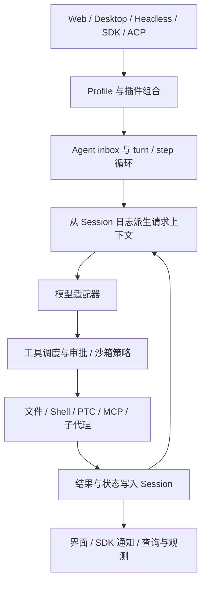

# DeepSeek Harness 当前全景

基线：**v0.2.1-alpha.2**／`d743267388641bc76f17c45ce8b4c231aed1d32c`，截至 2026-10-12。下面的产品能力来自该提交的官方文档；标注“源码核实”的条目还检查了实现。所有性能、交互、安全和可靠性结论均未经本项目运行验证。证据分级及长期机制见 [TRACKING](TRACKING.md)。

本页保持当前版本快照。历史 tag 的能力、默认值和迁移变化见 [EVOLUTION](EVOLUTION.md)：插件内核早期已存在；Session 格式、模型协议、执行后端及日志外发在后续发布中发生过实质变化，不能把本页能力倒推给所有历史版本。

2026-10-13 补充：逐项支持状态、证据程度与待核问题统一维护在 [CAPABILITY-MAP](CAPABILITY-MAP.md)；默认插件、官方可选与第三方的分类及发布包差异见 [PLUGINS](PLUGINS.md)。npm 包存在、配置挂载和实际具备外部服务能力分别确认。

## 当前判断

dsh 是可组合的 Agent 运行框架及本地交互产品，核心特色是连 agent loop、模型、工具、持久化和界面都可通过 Cordis 插件组装。对企业平台，它更适合作为执行内核与架构模式的研究对象；当前证据不足以把它视为完整的企业身份、租户、成本和合规平台。官方仍将其标为开发者预览，明确预告兼容性变化，并声明尚未安全审计。[README](https://github.com/deepseek-ai/deepseek-harness/blob/d743267388641bc76f17c45ce8b4c231aed1d32c/README.zh.md)、[架构](https://github.com/deepseek-ai/deepseek-harness/blob/d743267388641bc76f17c45ce8b4c231aed1d32c/docs/architecture.zh.md)、[SAFETY](https://github.com/deepseek-ai/deepseek-harness/blob/d743267388641bc76f17c45ce8b4c231aed1d32c/SAFETY.zh.md)

| 结论 | 本轮适用范围 |
|---|---|
| 采用 | 暂无运行时采用项；没有完成企业场景验证 |
| 验证 | SDK 完成语义、取消与恢复、日志外发控制、模型路由兼容、沙箱实际能力 |
| 借鉴 | 持久事件日志派生上下文、能力服务替换、独占与并行工具调度、显式任务状态 |
| 观察 | 实验性 Team、Python PTC、Worktrees、Auto review、兼容层与版本迁移 |
| 跳过 | 本轮不投入字体、语音输入等与企业平台核心判断关联较低的体验细节 |

## 1. 产品定位、交互与部署

官方提供 Web、Headless、SDK、SDK Minimal 和 ACP profile，Desktop 以 Electron 携带匹配的 dsh 运行时。Web 是工作区、会话、工具执行、文件产物与设置的交互入口；Headless 适合一次性程序调用；TypeScript 与 Python SDK 用 stdio JSON-RPC 驱动独立运行时；ACP 是自动化集成入口。部署姿态和是否有人交互由 profile 决定，不能将某一 Web 功能自动推广到 SDK 或子代理。[架构中的 profile 与 Desktop](https://github.com/deepseek-ai/deepseek-harness/blob/d743267388641bc76f17c45ce8b4c231aed1d32c/docs/architecture.zh.md)、[Web 指南](https://github.com/deepseek-ai/deepseek-harness/blob/d743267388641bc76f17c45ce8b4c231aed1d32c/docs/user/guide/index.zh.md)、[Python SDK](https://github.com/deepseek-ai/deepseek-harness/blob/d743267388641bc76f17c45ce8b4c231aed1d32c/python/sdk/README.zh.md)

Web 默认监听本机回环地址。当前版本支持指定 IPv4/IPv6 绑定、原生 TLS 和反向代理外部 URL。启动 token 与签名 cookie 承担浏览器认证；`--public-url` 只是公告地址，`--trusted-host` 是 authority 接纳，二者都不能替代认证或可信网络。证书文件只在启动时读取，不负责签发和续期。**推断：**企业远程服务化仍需单独设计入口访问控制、运行环境和运维职责；原生 HTTPS 并不意味着已交付企业 SSO/RBAC。[外部部署指南](https://github.com/deepseek-ai/deepseek-harness/blob/d743267388641bc76f17c45ce8b4c231aed1d32c/docs/user/guide/public-deployments.zh.md)

本轮在固定版本的身份包、用户指南和包目录中未找到可确认的企业多租户、SSO 或组织级 RBAC 产品契约。这里是检索范围内的证据缺口，不是证明任何扩展均无法实现。企业平台的适用性只讨论需求层面：如考虑接入，应让业务用户身份与权限由上层平台明确传入，不能从 dsh 的匿名安装 ID 推导。

## 2. 执行循环、规划、工具、子代理与长任务

下图是对固定版本架构的研究归纳，不是独立运行系统：

官方把一次模型请求及其工具执行定义为 step，若干 step 构成 turn。输入先进入持久 inbox，经 pre-step 和 request 扩展点后才准入模型历史。源码中，工具调度读取 `maxParallelToolCalls`，并行安全调用使用有界池，独占调用形成屏障；默认并发上限是 10。并发分类由工具声明和执行策略决定，不能据此假定任意两个写工具无冲突。[架构轮次流程](https://github.com/deepseek-ai/deepseek-harness/blob/d743267388641bc76f17c45ce8b4c231aed1d32c/docs/architecture.zh.md#turn-flow)、[循环实现说明](https://github.com/deepseek-ai/deepseek-harness/blob/d743267388641bc76f17c45ce8b4c231aed1d32c/packages/core/agent-loop/README.zh.md)、[调度源码](https://github.com/deepseek-ai/deepseek-harness/blob/d743267388641bc76f17c45ce8b4c231aed1d32c/packages/core/agent-loop/src/tool-calls.ts)

| 能力 | 当前语义与边界 | 企业相关判断 |
|---|---|---|
| 规划 | `/plan` 与 `exit_plan_mode` 管理计划与评审；计划模式主要是提示词约束，本身不禁止写操作 | **借鉴**计划交互；实际执行权限需沙箱和审批共同约束 |
| 工具 | 原生调用与 PTC（程序化工具调用）两种展示；本版移除 `both` | **验证**工具 schema、日志与 API 迁移 |
| 子代理 | 统一 activation，支持新建、fork、可继续本地子会话及外部后端；能力字段决定是否支持模型、persona、工具过滤等覆盖 | **借鉴**统一接口；跨后端能力不能按同一保证处理 |
| 并行协作 | 实验性 Team 有 Lead、teammate、任务板 CAS、依赖和直接 inbox 消息 | **观察**；任务路径重叠只是警告，无自动任务 owner 回收或跨进程协调 |
| 长目标 | Goal 在同会话空闲后推进下一轮，有 round 上限与 blocker；resume/fork 后不会自动重新启用续行 | **借鉴**显式恢复授权；round 限制不等于时间或货币预算 |
| 后台工作 | jobs 与工作流可持续运行；轮次结束、根代理 idle 与全任务完成是不同状态 | **验证**业务状态机、完成通知和收尾顺序 |

来源：[Plan 约束](https://github.com/deepseek-ai/deepseek-harness/blob/d743267388641bc76f17c45ce8b4c231aed1d32c/packages/plan/plan-mode/README.zh.md)、[Tools 类型](https://github.com/deepseek-ai/deepseek-harness/blob/d743267388641bc76f17c45ce8b4c231aed1d32c/packages/core/tools/src/types.ts)、[Subagent](https://github.com/deepseek-ai/deepseek-harness/blob/d743267388641bc76f17c45ce8b4c231aed1d32c/docs/subsystems/subagent.zh.md)、[Team](https://github.com/deepseek-ai/deepseek-harness/blob/d743267388641bc76f17c45ce8b4c231aed1d32c/packages/experimental/agent-team/README.zh.md)、[Goal](https://github.com/deepseek-ai/deepseek-harness/blob/d743267388641bc76f17c45ce8b4c231aed1d32c/packages/goal/goal-round-driver/README.zh.md)、[Jobs](https://github.com/deepseek-ai/deepseek-harness/blob/d743267388641bc76f17c45ce8b4c231aed1d32c/packages/jobs/README.zh.md)。

**源码核实：**SDK `session/wait` 会等待根 Agent、受管理后代和后代触发的后续活动，并复核 idle 状态；但 `HarnessSession.run()` 仍在根会话首次 idle 后返回，其 `finalResponse` 是该活动区间最后的根助手文本，不保证因果上只属于本次 prompt。对企业平台的异步任务回执而言，必须先定义“已接收、根轮次结束、子树完成、业务成功”四者的含义。[服务端 wait](https://github.com/deepseek-ai/deepseek-harness/blob/d743267388641bc76f17c45ce8b4c231aed1d32c/packages/sdk/server/src/server.ts#L214)、[客户端 run](https://github.com/deepseek-ai/deepseek-harness/blob/d743267388641bc76f17c45ce8b4c231aed1d32c/packages/sdk/client/src/api.ts#L187)、[SDK 契约](https://github.com/deepseek-ai/deepseek-harness/blob/d743267388641bc76f17c45ce8b4c231aed1d32c/packages/sdk/client/README.zh.md)

取消是协作式；源码与文档保留取消原因、失败 attempt、未启动和结果未知的工具状态。结果未知的副作用不能盲目重放。当前 release 修复了传输不响应 abort 时空闲超时仍挂起的问题，但超时返回与底层资源完全释放不是同一保证。持久会话恢复也不意味着进程、外部事务或后台作业已 exactly-once 恢复。根上下文关闭时最终 `turn/end` 可能未持久化，这是该版本官方记录的限制。[失败与取消](https://github.com/deepseek-ai/deepseek-harness/blob/d743267388641bc76f17c45ce8b4c231aed1d32c/packages/core/agent-loop/README.zh.md)、[超时修复](https://github.com/deepseek-ai/deepseek-harness/commit/dbb150ff0e589ec5b34a261c201a853affe71a29)

## 3. Context 压缩与 memory 边界

Session 是追加事件日志，模型上下文是其投影；工具、消息、压缩与替换保留可追溯记录。JSONL 持久化支持格式迁移，当前已发布逻辑格式是 v4。写打开历史格式时发布新的版本化 generation，保留原代际；不能从“保留旧文件”推导通用降级支持。硬中断若发生在流 settlement 之前，瞬态流 chunk 不一定形成持久 attempt。[架构日志](https://github.com/deepseek-ai/deepseek-harness/blob/d743267388641bc76f17c45ce8b4c231aed1d32c/docs/architecture.zh.md)、[格式状态](https://github.com/deepseek-ai/deepseek-harness/blob/d743267388641bc76f17c45ce8b4c231aed1d32c/docs/session-format-status.zh.md)

自动压缩先可选修剪超大工具结果，再用额外模型请求摘要旧的平衡历史区间，保留近期消息。默认阈值考虑上下文窗口、输出预算和额外余量；小上下文模型需要配置相应余量，否则可能在首次使用时拒绝配置。压缩不能缩小系统提示词、工具目录或不可分的超大调用，不保证语义无损，也不等于减少所有后续费用。修剪无需模型调用，摘要则有额外调用和缓存影响。[Compaction](https://github.com/deepseek-ai/deepseek-harness/blob/d743267388641bc76f17c45ce8b4c231aed1d32c/packages/compaction/compaction-basic/README.zh.md)

长期记忆要分三层理解：

- **会话内续接：**日志、压缩摘要和恢复支持同一会话持续工作。
- **跨会话检索：**会话查询／搜索能力取决于额外组合；不能从保存日志推导自动回忆全部历史。
- **外部记忆：**官方提供 Memorix、MCP Reference Memory、Engram 的默认关闭参考配置；服务器安装、数据、身份、embedding 和迁移由外部提供方负责。列入示例不代表 DeepSeek 的背书或支持承诺。

来源：[会话查询](https://github.com/deepseek-ai/deepseek-harness/blob/d743267388641bc76f17c45ce8b4c231aed1d32c/packages/session-query/README.zh.md)、[第三方记忆指南](https://github.com/deepseek-ai/deepseek-harness/blob/d743267388641bc76f17c45ce8b4c231aed1d32c/docs/user/guide/mcp-memory.zh.md)。**推断：**企业平台的业务知识应区分会话工作状态与长期事实；权限过滤、引用出处、冲突、保留和删除不能交给压缩摘要隐式承担。

## 4. 插件、Skills、MCP、模型、IM 与 SDK

当前随附可选组合有11项，默认模板均未选择；Codex／Claude Code 子代理另属官方按需安装。Web 会关闭部分基础工具，再由 preset 挂载；启用某些全局可选工具又会影响包括 minimal 在内的会话。插件功能范围因此必须携带 profile、preset 和配置条件。[分类与固定配置](PLUGINS.md)

插件通过服务、事件与生命周期副作用组合；profile 和 bundle 的层叠配置影响实际能力集合。Host 插件在宿主进程执行，不受工作区沙箱约束；插件管理的 profile 变更可能影响多个会话。源码中存在开关、加载失败处理和版本配套机制，不等于已经建立第三方插件信任或审计体系。[架构](https://github.com/deepseek-ai/deepseek-harness/blob/d743267388641bc76f17c45ce8b4c231aed1d32c/docs/architecture.zh.md)、[插件管理](https://github.com/deepseek-ai/deepseek-harness/blob/d743267388641bc76f17c45ce8b4c231aed1d32c/packages/boot/plugin-manager/README.zh.md)

| 接入面 | 已有证据 | 边界与建议 |
|---|---|---|
| Skills／AGENTS.md | 文件系统扫描项目、自定义与用户根；目录摘要和正文按需加载；本版支持共享 agents 指令目录 | **借鉴**发现与加载分离；指令不是安全权限凭证 |
| MCP | stdio、Streamable HTTP，工具与资源发现，分页、更新、取消及有限退避重连 | **验证**认证、超时、重连、恶意服务器指令；MCP prompt 模板不支持 |
| 模型 | DeepSeek 适配器及 pi-ai 多提供方／自托管网关，模型能力影响系统提示词与动态工具处理 | **验证**具体端点协议；不能把目录列出理解成所有功能完全兼容 |
| TypeScript／Python SDK | 独立运行时、JSON-RPC、事件订阅、会话工作目录 API | **验证**精确版本与自定义 runtime，尤其 session/wait |
| Claude Code／Codex | 按需官方组合包与外部子代理后端；另有实验性 Claude Code Mods 兼容层 | **观察**；兼容层并未承诺完整实用兼容 |
| IM | 固定版本目录与用户指南中未找到可确认的飞书、Slack、微信、Telegram 等官方消息机器人接入契约 | **未知**；社区链接、图标与飞书反馈表单不是 IM 运行入口 |
| Webhook | 实验性 GitHub 签名入口和通用规则 runtime，202 只表示通过验证并在内存分发 | **观察**；不等于规则成功或持久队列已接收 |

来源：[Skills](https://github.com/deepseek-ai/deepseek-harness/blob/d743267388641bc76f17c45ce8b4c231aed1d32c/packages/skill/skill-filesystem/README.zh.md)、[MCP](https://github.com/deepseek-ai/deepseek-harness/blob/d743267388641bc76f17c45ce8b4c231aed1d32c/packages/mcp/mcp-client/README.zh.md)、[pi-ai](https://github.com/deepseek-ai/deepseek-harness/blob/d743267388641bc76f17c45ce8b4c231aed1d32c/packages/llm/llm-pi-ai/README.zh.md)、[SDK](https://github.com/deepseek-ai/deepseek-harness/blob/d743267388641bc76f17c45ce8b4c231aed1d32c/packages/sdk/client/README.zh.md)、[上版兼容层声明](https://github.com/deepseek-ai/deepseek-harness/releases/tag/dsh-v0.2.1-alpha.1)、[GitHub webhook](https://github.com/deepseek-ai/deepseek-harness/blob/d743267388641bc76f17c45ce8b4c231aed1d32c/packages/experimental/webhook-github/README.zh.md)。IM 为限定范围检索所得，未声称不存在任何社区插件。

## 5. 身份、权限、审批、沙箱与审计

**入口例外：**`sdk-minimal` 使用独立组合，文件策略默认 `danger-full-access`，不继承 base 的 `workspace-write + ask` 默认值；其 tag 配置与本轮静态核验的 npm 配置一致。少工具模式不能当作较低权限的同义词。[固定配置](https://github.com/deepseek-ai/deepseek-harness/blob/d743267388641bc76f17c45ce8b4c231aed1d32c/packages/bundle/sdk-minimal/cordis.patch.yml)、[发布包核验](PLUGINS.md)

源码中的基础组合把新会话默认配置为 `workspace-write + ask`，另有 read-only 和 Full access 等预设。身份层需要区分模型提供方登录、Web 启动认证、匿名安装标识及真正的业务用户授权。匿名 ID 用于同一 Harness home 的关联，不是企业用户身份。[基础配置](https://github.com/deepseek-ai/deepseek-harness/blob/d743267388641bc76f17c45ce8b4c231aed1d32c/packages/bundle/base/cordis.patch.yml#L233)、[权限预设](https://github.com/deepseek-ai/deepseek-harness/blob/d743267388641bc76f17c45ce8b4c231aed1d32c/packages/interaction/permission-presets/README.zh.md)、[匿名 ID](https://github.com/deepseek-ai/deepseek-harness/blob/d743267388641bc76f17c45ce8b4c231aed1d32c/packages/identity/anonymous-user-id/README.zh.md)

本地沙箱按平台选择 Linux bwrap／Landlock、macOS Seatbelt 或 Windows ACL runner。不可用时明确失败；部分平台／ABI 会报告 `partial`。其文件策略并不提供完整网络隔离或多租户保证；允许读取的文件及已获授权的资源仍可能暴露。凭据本地文件的 OS 权限不能向同一 OS 用户运行的 Agent 工具进程隔离机密。[本地沙箱](https://github.com/deepseek-ai/deepseek-harness/blob/d743267388641bc76f17c45ce8b4c231aed1d32c/packages/sandbox/sandbox-local/README.zh.md)、[Python 文件策略范围](https://github.com/deepseek-ai/deepseek-harness/blob/d743267388641bc76f17c45ce8b4c231aed1d32c/packages/experimental/ptc-runtime-python/README.zh.md)、[本地凭据](https://github.com/deepseek-ai/deepseek-harness/blob/d743267388641bc76f17c45ce8b4c231aed1d32c/packages/credentials/credentials-local/README.zh.md)

实验性 Auto review 默认关闭，用当前模型审查工具后可能以 Full access 执行。它有额外调用成本，可能误判，不覆盖 PTC 程序所有直接 Node 效果；审查风险、prompt、reasoning 和原始响应不全部持久化。因此它是可研究的审批体验，不能直接充当企业确定性策略引擎或完整审计证据。[Auto review](https://github.com/deepseek-ai/deepseek-harness/blob/d743267388641bc76f17c45ce8b4c231aed1d32c/packages/experimental/auto-review/README.zh.md)

**推断：**企业接入需在 dsh 之外明确租户隔离、凭据代理、网络出站、审批身份与日志保留。事件可回放有助于排障，却不自动具备防篡改、审计访问控制、保留期或外部副作用证明。当前官方安全声明仍是决定采用姿态的首要依据；公开 advisories 暂无条目不改变它。[SAFETY](https://github.com/deepseek-ai/deepseek-harness/blob/d743267388641bc76f17c45ce8b4c231aed1d32c/SAFETY.zh.md)、[安全公告](https://github.com/deepseek-ai/deepseek-harness/security/advisories)

## 6. 日志、Trace、异常、升级、依赖与成本

Trajectory、Session 事件、开发者工具和统计投影提供执行观察依据。使用 SDK 重建记录应消费 `session/event`；`agent/*` 主要是实时协调信号。当前版本修正了若干请求、压缩和后台工作状态显示，说明用户界面状态必须与运行时终态分开检查。[生命周期](https://github.com/deepseek-ai/deepseek-harness/blob/d743267388641bc76f17c45ce8b4c231aed1d32c/docs/agent-lifecycle.zh.md)、[统计](https://github.com/deepseek-ai/deepseek-harness/blob/d743267388641bc76f17c45ce8b4c231aed1d32c/packages/session/session-stats/README.zh.md)、[版本增量](releases/v0.2.1-alpha.2.md)

数据外发有独立通道：默认的 `session-log-deepseek` 请求字段可增量携带完整规范事件；OTel 会话上报默认基于显式反馈释放日志前缀；另有插件包清单元数据。**源码核实：**基础 bundle 挂载 Session Log 插件，其 schema 的 `enabled` 默认为 true；不是关掉一个“遥测”开关就能推导全部外发关闭。外发目标、数据保留及自定义端点行为仍需逐项验证。[Session Log](https://github.com/deepseek-ai/deepseek-harness/blob/d743267388641bc76f17c45ce8b4c231aed1d32c/packages/session/session-log-deepseek/README.zh.md)、[配置源码](https://github.com/deepseek-ai/deepseek-harness/blob/d743267388641bc76f17c45ce8b4c231aed1d32c/packages/session/session-log-deepseek/src/index.ts#L38)、[OTel](https://github.com/deepseek-ai/deepseek-harness/blob/d743267388641bc76f17c45ce8b4c231aed1d32c/packages/session/session-telemetry-otel/README.zh.md)、[包清单](https://github.com/deepseek-ai/deepseek-harness/blob/d743267388641bc76f17c45ce8b4c231aed1d32c/packages/llm/plugin-package-inventory-deepseek/README.zh.md)

| 运维面 | 当前证据及适用边界 |
|---|---|
| 异常升级 | 结构化工具结果区分未启动、结果未知、拒绝和取消；持久化失败或未表示的运行异常应显式失败，不当作业务成功 |
| 升级 | 预稳定 API 存在破坏变更；Session 数据格式独立版本化。插件、SDK、runtime 与历史会话都要列入版本检查 |
| 依赖 | 本版 pi-ai 从 0.87.1 到 1.0.2，另有协议、运行工具、图片和渲染依赖变更；本项目未扫描 CVE 或验证发行包供应链 |
| 成本 | 主循环多步、子代理、摘要、标题、重试和 Auto review 都可能增加请求；token 统计和单次输出上限不构成全任务货币预算 |
| 运维未知 | 缺少本项目实测吞吐、时延、长任务成功率、崩溃恢复指标及按业务任务归集的真实费用 |

来源：[循环故障语义](https://github.com/deepseek-ai/deepseek-harness/blob/d743267388641bc76f17c45ce8b4c231aed1d32c/packages/core/agent-loop/README.zh.md)、[LLM 重试](https://github.com/deepseek-ai/deepseek-harness/blob/d743267388641bc76f17c45ce8b4c231aed1d32c/packages/llm/llm-retry/README.zh.md)、[依赖锁文件](https://github.com/deepseek-ai/deepseek-harness/blob/d743267388641bc76f17c45ce8b4c231aed1d32c/pnpm-lock.yaml)、[Goal 资源预算限制](https://github.com/deepseek-ai/deepseek-harness/blob/d743267388641bc76f17c45ce8b4c231aed1d32c/packages/goal/goal-round-driver/README.zh.md)。

对企业平台，当前最有价值的下一步是形成可独立验证的接入要求：任务完成判据、外部动作不明时的处理、每个出站通道的控制、知识与会话状态分层，以及明确的预算所有者。此判断基于公开资料，不涉及特定产品的私密实现。

补充的插件核查确认，Desktop 产品交互埋点与反馈遥测是独立通道，普通 Web 不装配该产品通道；默认启用、可配置关闭及已排队事件的行为见 [PLUGINS](PLUGINS.md)。另外，文件卡片的 Host 打开、会话 ZIP 下载和鉴权文件读取是不同能力；逐项证据与限制见 [CAP-FILE-02～06](CAPABILITY-MAP.md#工作区与文件交付)。
