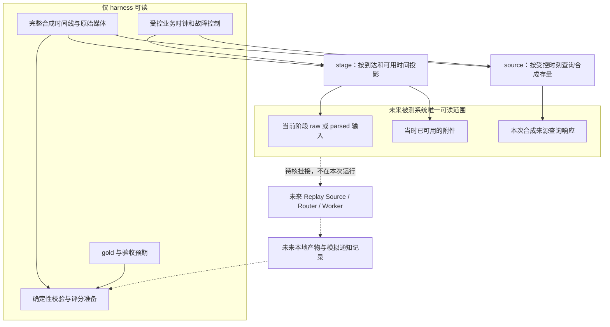
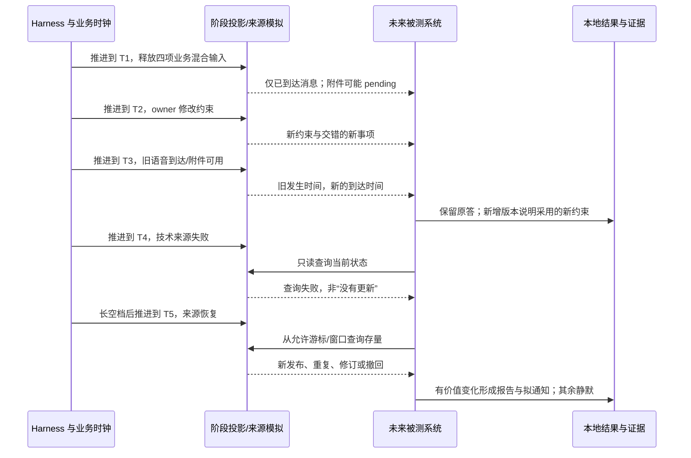

# 四项交错业务与受控回放实施补充

> 2026-11-10。此文补充 [PLAN.md](PLAN.md)，不替代原计划，不修改旧 `corpus/`。新增材料位于 `business-corpus/`。当前 fixture 为 48 条投递、47 个唯一源消息、16 批、15 个附件，业务窗口为 2026-11-16 至 2026-11-30（Asia/Shanghai），投递最短间隔 2 秒、最长 276352 秒。计数是材料属性，不是运行性能。

本次范围是中文文档、合成离线材料及确定性回放准备工具；没有运行 Superagent、调用模型、连接真实渠道或向真实用户发送通知。

## 1. 要验证什么

以同一办公团队的一段连续工作时间为背景，让四项业务自然交错，而非四个彼此隔离的问答：

| 业务 | 输入与变化 | 将来需要观察的业务成果 |
|---|---|---|
| 采购比选 | 需求表、报价图片/PDF、口头补充、税费和交付条件、预算变更 | 有依据的可比报价与待确认项；不把比较建议当成下单许可 |
| 项目例会与交付 | 会议纪要、任务分工、版本文件、交付状态、延期及验收补充 | 当前责任人与截止时间、最新交付物和未完成依赖；发出文件不等于验收通过 |
| 部门活动 | 人数、场地方案、费用、图片/视频、时间调整和取消 | 符合最新人数、预算、时间的方案；不预订、不付款、不擅自邀请 |
| 持续技术资料搜集 | owner 的兴趣范围，大模型新闻与 DeepSeek plugin 合成更新；来源失败、恢复、修订和撤回 | 对兴趣相关性、证据可靠性与变化价值作判断，整理有用报告并在本地记录拟通知；无价值变化时保持安静 |

第四项明确取代“行业政策与项目机会关注”。技术 feed 中的产品名、版本号、日期、功能、发布说明都是测试用假发布，不代表真实 DeepSeek 产品能力或新闻。材料需有明显合成标记，不冒用真实官方公告 URL。

成功不是“每条消息都回复”：应能区分闲聊、材料、授权、撤回、旧消息回补与新任务，并在四条业务线中保存依据。此阶段只准备检验条件，不提前填写模型业务通过结果。

## 2. 业务世界与输入组织

### 2.1 多来源、扁平群、owner 私聊

设置若干虚构群会话与 owner 私聊。群是多人、多事项混杂的扁平时间线，`native_thread_id` 缺失时保持为空；不能预先按事项拆成模型的四个专属线程。同一事项可以从采购群转入项目群，也可以由 owner 私聊修改约束；同一群可同时讨论采购、交付和活动。

- 渠道名称只是合成来源标签，不表示已实现 Slack、企微或微信连接。
- 稳定消息 ID、发送者、会话、引用/回复与时间是可见证据。案例编号、期望任务归属和评分标签只归 harness。
- owner 与普通成员有明确合成身份映射；显示名相同不证明同一人。引用、截图、转发和供应商文本不自动成为 owner 授权。
- owner 私聊中的信息不因此获准公开到群。将来的输出应核对原会话与可分享范围，本次只记录本地拟输出。
- 现实感来自合理信息缺口和逐步变化，不来自复制真实群记录或私有项目材料。

### 2.2 媒体与多批次

组合可实际打开的文字、表格/文件、图片、音频和视频。当前每份原始媒体有来源事件和校验 hash。d023 录音消息于 11 月 18 日 08:51:05 到达，raw 文件到 08:53 才可读，parsed 对照到 08:54 才可读；pending 阶段没有文件引用、媒体字节或提取文本。增量阶段在可用时生成非人类 `media_ready` 派生事件，引用原消息，不重新授予旧约束。48 条业务投递之外，每臂有 1 条此类媒体可用事件。损坏 PDF 的解析对照状态为失败。这里实现的是素材可用时间门控，不是实际 ASR 或异步解析器运行。不能用文件扩展名代替有效媒体，也不能把存在转录文本算作已理解原始音视频。

两条配对输入臂保持相同的业务消息、身份、时间与权限：

- `raw`：原始媒体及用户当时实际发送的文字，不混入金标准转写。
- `parsed`：人工核对的解析材料作为对照，保留其派生关系；不包含标准业务答案、期望任务归属和未来事实。

两臂未来运行时使用独立状态、会话与产物目录。解析对照用于定位媒体链路差异，不替代原始媒体验收。

### 2.3 节奏不是均匀定时器

时间线应含秒级连续输入、数分钟的跨事项密集混发、数小时乃至跨日空档，以及离线后短时间集中回补。每次间隔由业务情境决定，不按固定周期机械平铺。

一个示意片段：09:02 采购需求，09:02:17 项目交付补充，09:02:24 活动人数调整，09:03:10 报价图片；随后长空档，午后 owner 私聊下调预算；次日收到前一天已发出的语音；更晚技术来源恢复并出现修订。示意不是脚本保证的实际事件表，实际时间与数量以生成材料为准。

同时保留：

1. **发生时间**：发送或源内容发布的业务时刻。
2. **到达时间**：输入真正可被接收的业务时刻。阶段释放依据到达/可用时间，不是发生时间。
3. **附件可用时间**：附件可能晚于消息到达；不能提前复制其内容。
4. **运行墙钟时间**：未来真实运行的接收、调用、读取、采用、完成时间。

同一到达时刻使用稳定的确定性序号。晚到旧材料不能自动覆盖后来授权的预算或截止时间；应依据作者、版本、发生时间、引用及当前约束判断。

## 3. 架构与保密边界



当前没有实现 OS 沙箱。完整隔离依赖未来仅单独挂载输出目录，并禁用完整仓库与外网读取。投影不是安全沙箱。若被测进程仍能读父目录、完整语料、生成脚本中的未来情节、gold 或其他运行臂，阶段隔离无效。未来运行时只挂载投影目录与必要工具；完整仓库和 harness 控制目录不能一并暴露。原型的独立 Session/目录不等于文件权限隔离。

控制事件不是群聊消息，故障剧本和未来恢复时刻不交给模型。`source` 是离线存量响应模拟，不是现成 Superagent 插件，也不证明原型支持自主持续业务 watch。后续若把查询工具暴露给被测系统，必须由 harness 绑定当前时钟，拒绝越过当前时刻的请求；不能让模型任意传未来 `--at` 获取答案。

## 4. 工具与受控时钟

拟交付 `generate.py`、`validate.py`、`replay.py`。执行入口、相对路径、依赖版本、输出文件名和最终支持的参数，以 [business-corpus/README.md](business-corpus/README.md) 与实际脚本为准。本节不承诺未实现的注入、调度、恢复或通知 CLI。

已经实现的主要回放准备接口为（实际运行使用 Python 调用脚本）：

```text
replay.py stage --until RFC3339 --arm raw|parsed --out 新目录
replay.py source --at TIME --source llm-news|deepseek-plugin|delivery
```

`raw|parsed` 和三个 source 名称表示选项集合，调用时选择一个值，不原样输入竖线。TIME 使用含时区的明确时刻。`stage` 是时点物化，不是实时或加速调度器。可选 `--after` 筛选 `(after, until]` 到达的消息，并为已到达消息在该窗口中新可用的媒体生成 `media_ready`；来源文件仍是 until 时刻完整快照。`source` 另支持 `--if-none-match` 返回 304，且只供 controller 使用。`stage` 生成截至该时刻的阶段快照，不能将重复生成快照当作新增消息重复投递；未来注入器需维护已接收 ID/版本或明确采用全量重建策略。

- `generate.py`：构造固定可重建的合成材料和时间线，不获取真实技术新闻。
- `validate.py`：核对格式、引用、时间、媒体、标记、隔离和覆盖要求；它通过不等于 Router 理解通过。
- `stage`：仅释放截至受控时刻已到达的输入，按 raw `available_at` 或 parsed `reference_available_at` 门控附件；未可用时只保留 pending 元数据，可用后才复制文件或附上解析对照。它不执行真实解析任务、Worker 屏障或进程操作。未到达内容不应藏在目录清单、派生摘要或附件路径内容中提前暴露。
- `source`：以受控时刻返回 `llm-news`、`deepseek-plugin`、`delivery` 合成来源当时的可读状态。目前包含失败、无变化、有更新、内容更正和撤回：n103 的 revision 3 于 11 月 27 日 15:45 发布，15:50 来源恢复后才可见，否定此前成本结论；owner 停止/恢复跟踪在消息流中。来源查询没有游标或可回补窗口机制。发布时刻与来源观察可用时刻不混淆。

业务时钟可以快速推进数小时或跨日来验证条件、窗口与事件顺序；墙钟仍按真实执行记录。加速跨过一天不证明系统能连续稳定运行一天。离线准备阶段不存在真实路由延迟或模型成本，不能据此报 p95 或端到端 SLA。

## 5. 时序与变更规则



图中 R/O 为未来测试行为，不表示本次已运行。保留初始原答与后续修订，不回写历史答案让轨迹看似一直正确。新约束至少分别检查“已送达、已读取、已采用、产物已更新”；不能以投递成功替代采用证据。

### 5.1 技术资料业务 watch

业务 watch 根据明确兴趣持续判断“是否值得整理给用户”，不是把所有 feed 更新转发。兴趣应由合成 owner 指示，例如关注适合办公协作的 agent 能力、插件兼容性和可复现的工程变化；材料需包含相关、无关、证据不足和重复内容，使选择有实质意义。

报告的可接受内容包括：这次变化是什么、与兴趣的关系、来源及版本、已知限制、值得跟进的下一步。合成假新闻仍须明确标注。无证据不得把宣传语写成实测结论。

### 5.2 三类观察不可互相替代

| 观察 | 触发依据 | 关注结果 | 不能证明什么 |
|---|---|---|---|
| 技术资料业务 watch | 来源变化、兴趣和价值阈值 | 有价值报告/拟通知，重复或无关静默 | 查询成功不等于任务已完成或进程健康 |
| 任务滞后观察 | 未完成依赖、截止时间、约定检查点 | 标明卡点、需谁补充，必要时请求决定 | 没有群消息不等于任务卡死；逾期不应靠重启“修复” |
| 进程健康检查 | 进程、队列、错误和心跳等运行证据 | 尊重停止标志的故障报告或受控恢复 | 进程活着不等于业务推进，更不等于应通知用户 |

本次仅准备三类观察的材料和预期，不启动真实监控或自动恢复。`controller/clock-plan.json` 列出工作日 09:00/16:00 tick、消息投递与控制点，是待执行剧本。stage 不执行该日程、不维护上次成功检查记录，也不执行停止/复工策略；这些是未来被测系统的业务行为，不是脚本已完成能力。原型内部 Passes 与部署健康检查不能被命名为已实现本业务 watch。

### 5.3 故障、恢复与通知判定

| 条件 | 可接受规则 | 应保留证据 |
|---|---|---|
| 来源失败/无权读取 | 记录失败与已知缺口，不解释成无变化，不编造新内容 | 查询时刻、状态、最后成功状态；未来重试范围 |
| 成功但无变化 | 不重复生成同一报告或提醒 | 来源版本/内容指纹及比较依据 |
| 来源恢复 | 按可回补窗口补查，合并同一事项，保留历史发生时间 | 中断区间、恢复时刻、返回范围和未恢复缺口 |
| 旧发布晚到 | 评价其当前价值；不得自动覆盖更新版本 | 发布时间、到达时间、修订关系 |
| 来源更正/撤回 | 旧内容保留历史但标失效；若影响已报告结论，形成更正版本 | 原报告、撤回依据、新旧结论变化 |
| owner 停止/撤销 | 停止受影响任务或通知范围，不因来源恢复自动复工 | 身份、撤销范围、当时约束；重新启动须有有效依据 |
| 重复投递/转载 | 按稳定消息 ID/修订和内容关联去重；不同来源提供独立证据时保留来源 | 去重键、原事件、是否新增实质信息 |
| 离线窗口 | 只返回该时刻可知的存量；不可回补部分显式未知 | 可用窗口、游标或范围，实际返回输入 |
| 模拟通知结果未知 | 保持未知，先核对本地收件记录，不盲重发 | 请求键、内容 hash、可回读回执 |

不同内容不能因标题相同被误去重。来源修订和撤回不能因 ID 相同被当成重复丢弃。来源健康故障是否值得打扰 owner 取决于是否影响重要承诺，不机械地每失败一次发一条。

## 6. 固定版本与 B0/B1/B2 边界

固定原型：[`8c32a9dc5d72c033816c6a8110b37f40cf94fba4`](https://github.com/deepseek-ai/dsh-superagent-prototype/tree/8c32a9dc5d72c033816c6a8110b37f40cf94fba4)。以原计划中的原样/适配/扩展分层为准：

- **B0 原样基线**：只记录固定版本真实已有能力与不可观测字段；不能改核心、prompt 或默认 policy 后仍称原样。
- **B1 输入适配与对照**：明确登记回放包装、媒体解析和工具适配的差异，分别运行 raw/parsed；适配器不得预填业务归属或答案。
- **B2 业务扩展**：新增持续业务观察、事实/约束采用追踪或动作前保护等，独立登记、独立比较，不能归功于固定原型。

本次本地脚本的成功只证明材料生成、校验、时间投影与合成查询准备。不证明 Source 注册成功，不证明公开 SDK 可用，不证明真实 Runtime 已越过 setup/gate，不证明 Router/Worker 或音视频理解通过。固定源码复核还须注意：`Trigger.at` 不是预约调度字段，Intake 收到即入队；内部约每 2 秒 Pass 不是业务 watch；`Setup.resolve` 仍无条件要求 GitHub setup，不能假定非 GitHub 来源免 setup。后续挂接仍遵守原计划的 Source/exports/setup 核验和授权门槛，不能向任意 HTTP 入口注入或改 SQLite 冒充接入。

本轮静态回读的固定证据：[Intake接收](https://github.com/deepseek-ai/dsh-superagent-prototype/blob/8c32a9dc5d72c033816c6a8110b37f40cf94fba4/src/core/intake.ts#L19-L60)、[内部Passes](https://github.com/deepseek-ai/dsh-superagent-prototype/blob/8c32a9dc5d72c033816c6a8110b37f40cf94fba4/src/app/passes.ts#L17-L69)、[Setup.resolve](https://github.com/deepseek-ai/dsh-superagent-prototype/blob/8c32a9dc5d72c033816c6a8110b37f40cf94fba4/src/app/setup.ts#L76-L97)、[外部小时健康检查](https://github.com/deepseek-ai/dsh-superagent-prototype/blob/8c32a9dc5d72c033816c6a8110b37f40cf94fba4/docs/006-deployment.md#hourly-check)、[Worker输入](https://github.com/deepseek-ai/dsh-superagent-prototype/blob/8c32a9dc5d72c033816c6a8110b37f40cf94fba4/src/executor/dsh.ts#L112-L128)、[恢复与停止的授权边界](https://github.com/deepseek-ai/dsh-superagent-prototype/blob/8c32a9dc5d72c033816c6a8110b37f40cf94fba4/docs/002-authorization.md#resume-and-stop)。原型权限变化会通知活跃Ticket，不保证即时撤销其Mandate；动作前最新授权复核仍属拟建。observe不关闭显式任务，不能拿它替代副作用沙箱。

## 7. 分阶段实施与具体验收

不增设复杂审批系统或新管理后台。每阶段保留最小可回读证据；“通过、失败、未运行、未覆盖、不可观测”分开记录。

| 阶段 | 本阶段工作 | 出口验收与证据 |
|---|---|---|
| A：合成材料 | 在新目录生成四业务、多来源、媒体与不均匀时间线 | 生成日志、文件清单/hash、媒体可打开性检查；能指出每业务初始请求、增量、约束变化与结果预期；旧 corpus 不变 |
| B：确定性回放准备 | 校验时间与引用，生成 raw/parsed 阶段，查询三个合成来源 | 重复生成一致；时刻边界前/等于/后测试；未来消息、晚到附件和 gold 不泄漏；成功/失败/恢复/无变化/撤回具有可复现响应 |
| C：后续框架契约 | 另行开展受控接收、去重和恢复实验 | 固定源码/配置 hash、真实挂接方式、逐事件接收结果；替身成功只记契约通过，不记模型业务通过 |
| D：后续业务评测 | 获得授权后再运行 B0/B1 与媒体对照 | 独立运行状态，原始输出不改写；逐事项事实、采用版本、来源、实际产物和拟通知回读；未运行项不填零失败 |
| E：后续扩展决策 | 根据证据决定 B2 的最小增量 | 每项改动对应失败、预期收益和重新验证范围；真实渠道/发送仍独立授权 |

A/B 的关键检查清单（下列是目标，不表示当前 validate 已逐项覆盖）：

1. 至少有四业务混合的密集片段和长空档，报告实际间隔分布与示例，不用“随机时间”一句替代检查。
2. 同一事件的发生时间、到达时间、附件可用时间可追踪；存在晚到/离线回补场景。
3. 对同一截止时刻生成两臂，消息身份、时间与业务文字一致；差异只来自声明的媒体表达，不混入业务 gold。
4. 每个阶段递归检查所有可读文件，不仅主 JSON；未来事件、未可用附件、答案和控制剧本均不能提前可读。
5. 查询时间边界与离线窗口可复现；失败与空结果有不同语义；恢复后不能读到未来版本。
6. 覆盖重复、修订、撤回、停止后来源恢复，以及来源不可回补缺口。覆盖清单不是被测系统通过记录。
7. 语料、脚本和文档明确“合成”；没有凭据、真实私人材料、真实外发或真实产品发布断言。
8. 保留命令、退出状态、生成/验证版本与实际检查结果，失败不通过编辑输出掩盖；不声称未执行的媒体/渲染检查已通过。

后续业务评测再增加：采购关键价格/税费/预算不混淆；交付“已发出/已收到/已验收”分开；活动使用最新约束；技术报告有兴趣关联和来源、不重复通知、撤回能更正。授权越界和未来泄漏单独判失败，不能用平均分抵消。

### 7.1 当前实现审阅与待补检查

当前 validate 已检查固定计数、非均匀间隔、发生/到达时间差、重复消息一致性、部分媒体可解码、输出目录不可覆盖、时间倒序拒绝、source 的 304/503/恢复、更正及撤回。新增校验遍历所有消息、来源状态、媒体可用边界的前 1 秒/恰好/后 1 秒；在各时点比较 raw/parsed 的非附件字段，核对 pending 不含引用/提取、可用后释放内容，并以全部输出文件白名单检查额外文件泄漏。增量 `media_ready` 和两臂不同可用时间也有专门断言。这些证明固定语料的投影准备检查通过，不是任意输入的安全证明。

仍保留的边界：

- 来源是时点全量快照，没有游标或有限离线回补窗口；不能称游标恢复测试已通过。
- 素材门控不等于真实媒体解析，控制计划中的 Worker/通知屏障和进程停止尚未执行。
- 无变化、停用或尚未被用户授权跟踪的源仍可能存在于阶段 sources 文件中；这是可用数据，不代表已执行合规检查或用户应收到通知。未来 controller 要把可读状态、实际查询轨迹和拟通知轨迹分开留证。
- 没有 OS 沙箱；只有未来实际隔离挂载、禁用仓库/外网读取后，才能审查模型的真实可读范围。
- 业务 checkpoint 仅供评审，不能挂载给被测系统。每项必须只引用截至 checkpoint 时刻已到达的证据；未来检查结果应另设时点，不能倒填。

## 8. 最小证据包与完成口径

本次交付应包含新增文档、生成材料、脚本使用说明、已实际执行的确定性检查结果及已知限制。未来运行另保存输入投影 hash、受控业务时刻、真实运行时刻、固定版本、原始回答、后续修订、产物和本地收件记录；运行可靠性与业务结论分别汇报。

这里仅采用通用设计启发：**阶段输入隔离、原答不改、版本冻结、运行与业务结论分开**。不复制、引用或公开任何私有 matterwise 材料，也不把合成世界中的结果写成实际项目事实。

完成这次准备工作的准确表述是：“四项交错业务的合成材料和确定性回放准备已完成，并列出实测校验与限制。”不能表述为“Superagent 已能持续执行这些业务”或“DeepSeek plugin 更新已经得到验证”。
